<p align="center"></p>

My personal portfolio. I'm a data analyst who hunts the problems a business can't hear yet: customers slowly drifting away, fraud that trips no alarm.

Built with **React** and **Vite**.

## What's in it

- **Hero** with a synthetic brain that grows its own connections, drawn on a canvas.
- **Animated charts** (ECharts) beside each project story, using example numbers.
- **Cards that react**: an electric current on hover and a pulse round the edge on click.
- **Two portals**: "See the work" opens like a spellbook, "Get in touch" opens like a pair of stone doors. Each leads to a focused view with a way back.
- **Contact cards** for email, phone, GitHub and LinkedIn.

## Run it

```bash
npm install
npm run dev      # start the dev server
npm run build    # production build in dist/
npm run lint
```

## Where things live

| Path | What it holds |
|---|---|
| `src/data/content.js` | All the text: profile, skills, projects, jobs, contacts |
| `src/components/` | Hero, the page sections, shared UI pieces |
| `src/charts/` | Chart setup, example data and chart components |
| `src/brain.js` | The brain animation |
| `src/zap.js`, `src/portal.js` | Card effects and the book / doors transitions |
| `src/index.css` | Design tokens and all styles |
| `design/` | The original HTML design the app was ported from |
| `docs/adr/` | Architecture decision records |
| `github/` | Generator for the animated README banners used across my repos |

---

<sub><b>the silent data</b> · Kennedy Njoroge · Nairobi, Kenya</sub>
