


Most problems are loud. The expensive ones are quiet: customers slowly drifting away, fraud that trips no alarm. **I find them while they're still small.**

I'm the only analyst across two businesses at Ahadi Wireless (Konnect), an internet provider and a water delivery service, covering customer, revenue and operations analysis. Based in Nairobi, Kenya.


<a href="https://github.com/kente001/kente_dw"></a>
<a href="https://github.com/kente001/airflow-kente"></a>
<a href="https://github.com/kente001/End-to-End-Data-Analysis-Project"></a>
<a href="https://github.com/kente001/Customer-Segmentation-RFM-K-MEANS-"></a>
<a href="https://github.com/kente001/Excelerate-EDA-Project"></a>
<a href="https://github.com/kente001/silent-data-portfolio"></a>


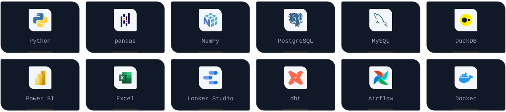

<a href="https://github.com/kente001?tab=repositories"></a>

